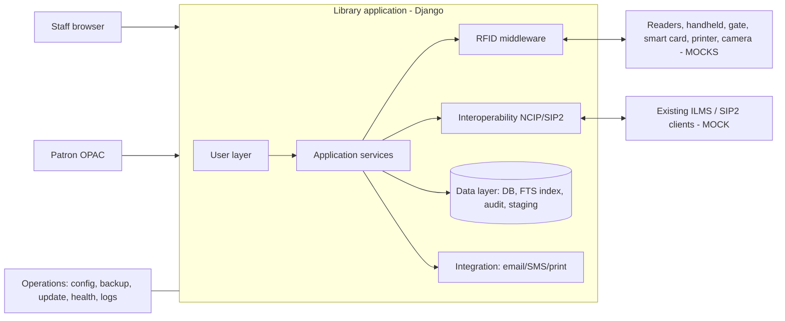
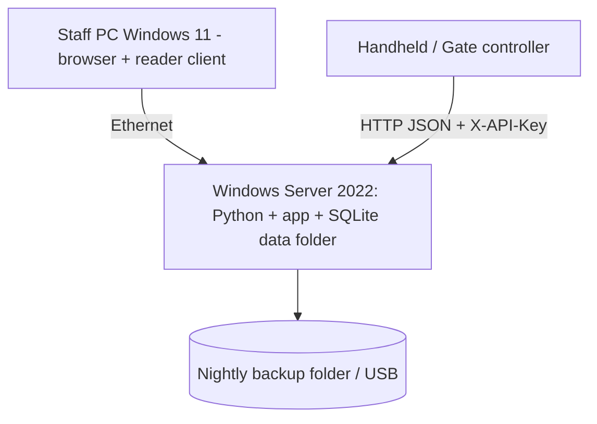

# D2 Architecture package

## Technology choices (and why)
| Choice | Reason | Production alternative |
|---|---|---|
| Python 3.12 + Django 5.2 | Built-in auth, groups, admin, ORM and versioned migrations; few dependencies = easy offline install and licence audit | Same |
| SQLite (WAL-capable, single file) | Zero-install, atomic online backup API, ideal for isolated demo | PostgreSQL (change `DATABASES`; backup via pg_dump) |
| SQLite FTS5 + Django signals | Real-time full-text index with no extra service | OpenSearch / Meilisearch behind `catalog/search.py` |
| Adapters for every device/provider | Vendor SDKs are unavailable; mocks prove the contracts | Implement the same abstract classes with vendor SDKs |

## Context

## Layer to folder map (SOP section 6)
| Layer | Code |
|---|---|
| User layer | `templates/`, `core/views.py`, `catalog/views.py`, `reports/` |
| Application layer | `catalog/`, `circulation/services.py`, `members/`, `notifications/`, `reports/`, `core/roles.py` |
| RFID middleware | `rfid/adapters.py` (interfaces + mocks), `rfid/services.py`, `rfid/views.py` (JSON API) |
| Interoperability | `interop/ncip.py`, `interop/sip2.py` |
| Data layer | `*/models.py`, `*/migrations/`, `catalog/search.py`, `core.AuditLog`, `migration_tool.StagingRow`, `core/ops/backup.py` |
| Integration layer | `notifications/services.py` providers, `MockCamera`, `MockPrinter` |
| Operations layer | `.env`, `core/config.py`, `core/ops/`, `/health`, `scripts/`, `data/logs` |

## Key design decisions
1. **Non-destructive integration**: the importer only inserts; every row carries `import_batch`; backup precedes any commit; `backup.fingerprint()` proves existing data is unchanged.
2. **Idempotent device events**: `DeviceEvent.event_id` is unique; duplicate gate events return the first result with no new alarm/e-mail.
3. **Denials are audited**: circulation denials are written outside the rolled-back transaction, so blocked attempts are never lost.
4. **Offline gate**: `export_gate_cache` snapshots tag security bits to JSON; gates decide from the cache when `LMS_ONLINE=false`. Cache must be refreshed on a schedule (stale-cache risk documented).
5. **Signed updates**: HMAC-SHA256 manifest signature + per-file SHA-256; protected paths (`data/`, `.env`) can never be overwritten; pre-update snapshot enables rollback.
6. **Security controls**: RBAC by group, CSRF on UI, API key (constant-time compare) on device/interop endpoints, XML DTD/entity rejection, request size limit, CSV formula-injection guard, masked logs, append-only audit model.

## Deployment (isolated site)

Place a TLS-terminating reverse proxy (IIS ARR or Caddy, bundled offline) in front for encrypted transport.

## Database (main entities)
Biblio 1-n Item 1-0..1 RFIDTag; Item 1-n Loan n-1 Member; Member 1-n Fine; Transaction (history); DeviceEvent, GateEvent, InventorySession, TagEvent; Notification; AuditLog; ImportBatch 1-n StagingRow.
